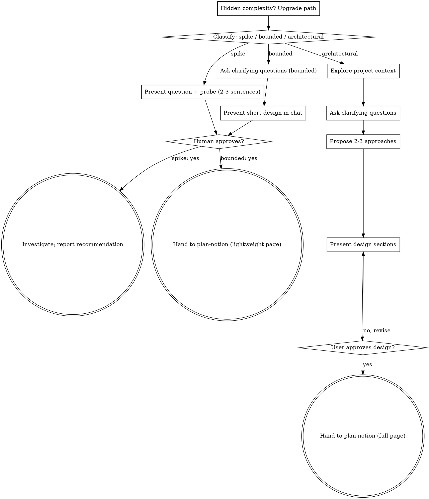

# Brainstorming Ideas Into Designs

## Suis-je la bonne version ?

Au chargement, vérifie que ce skill est bien la copie installée (une copie
périmée a déjà fait travailler une session sur de mauvaises règles) :

```bash
python3 -c 'import json,os;d=json.load(open(os.path.expanduser("~/.claude/plugins/installed_plugins.json")))["plugins"]["methode-de-travail@atelier"][0];print(d["version"],d["installPath"])'
cat "${CLAUDE_PLUGIN_ROOT}/.claude-plugin/plugin.json" | grep '"version"'
```

Les deux versions doivent être identiques, et `${CLAUDE_PLUGIN_ROOT}` doit être
l'`installPath` affiché. Écart : le dire à Benjamin en une ligne, puis lire ce
fichier et `_partage/` depuis cet `installPath`. Historique de la garde :
`historique.md`.

Help turn ideas into fully formed designs through natural collaborative dialogue.
Reply in the user's language.

Start by classifying the request, then work through your path: understand the
context, refine the idea, present a design, get approval.

<HARD-GATE>
Do not invoke an implementation skill, write code, scaffold a project, or take
any implementation action until the user has approved what you intend. Reason: a
plan written on a design not yet accepted costs a rewrite. This holds on every
path: the ceremony scales with the task, the gate does not.

Plan-mode exception: while Claude Code's native plan mode is active, create no
Notion page, on any path. The native plan is then the only authoritative plan;
two competing plans would make it ambiguous. Otherwise, the output goes through
`plan-notion` (see "Où va la sortie" below).
</HARD-GATE>

## Three Paths

Before your first question, classify the request and say the classification out
loud ("this looks bounded, so I'll present a short design here rather than a full
plan") so the user can override it:

- **Spike**: a feasibility question ("can we...", "is it possible...", "quick and
  dirty is fine") whose output is an answer, not code you keep. Present the
  question and what you'll try in 2-3 sentences, get a nod, then find out as
  cheaply as correctness allows. No design doc, no Notion page. Report findings
  as a recommendation; anything built stays labeled throwaway.
- **Bounded**: a well-scoped change to code that already exists in this repo: a
  new flag, a small endpoint, a one-file fix. Knowing the kind of app is not
  enough: bounded means the flow you change is already here to read. If there is
  no existing flow to change, the task is not bounded. Ask the questions that
  matter, present a short design IN CHAT (a few sentences to a few short
  paragraphs), and STOP until the user says yes.
- **Architectural**: new projects, new subsystems, changes that restructure how
  components fit together or alter interfaces others depend on. Follow the full
  process: questions, approaches, sectioned design, then hand over.

When in doubt between two paths, name both paths and ask the user which one to
take. The ratchet is one-way: hidden complexity discovered mid-task upgrades the
path. Stop, say so, and step up. Nothing downgrades mid-task.

## Où va la sortie : la frontière avec `plan-notion`

This skill produces no artifact itself: `plan-notion` writes. The output is sized
to the classified path, because a full page for a rename costs as much as a
full page for a redesign:

- **Spike**: no Notion page. The answer (finding, recommendation, throwaway code
  labeled as such) stays in the chat.
- **Bounded**: a lightweight `plan-notion` page: `Cartes`, `Besoins`, `Maquette`,
  `Exécution`, `Journal d'exécution`. `Maquette` carries the mockup as soon as a
  step changes what is displayed, or a written waiver (`plan-notion`, §3).
  `Questions ouvertes` only if a question is actually open. Same rule as any
  page: nothing is coded before the page reaches `valide`.
- **Architectural**: the full `plan-notion` page, all chapters.

Native plan mode (see the HARD-GATE) overrides all three.

**The boundary with `plan-notion`'s survey.** This dialogue explores intent,
constraints and approaches WITH the user. The fact-gathering on the repo (the
`enqueteur` and `chercheur` agents, the survey of `plan-notion`) comes AFTER the
design, in `plan-notion`. This skill does not map the neighbourhood of the code
and does not write the plan.

## Red Flags

| Thought | Reality |
|---------|---------|
| "This is too simple to need a design" | Simple means a short design, not no design. Two sentences in chat, then approval. Simple tasks are where unexamined assumptions waste the most work. |
| "I'll call it bounded and skip the spec" | Reaching for a label to skip work is the doubt: name both paths and ask. |
| "The design is obvious, I'll start while they read it" | The gate is the approval, not the length of the design. Present, then wait for the yes. |
| "I understand this kind of app, so it's bounded" | Bounded measures the repo, not your familiarity. A new project has no existing flow: it is architectural. |
| "The spike works, so I'll keep the code" | A spike's output is an answer. Keeping the code is a new request: classify it. |
| "It grew, but I'm almost done, no need to re-classify" | Hidden complexity upgrades the path mid-task. Stop and say so. |
| "They approved the spike, so the follow-up change is approved too" | Each task gets its own classification and its own approval. |

## Checklist

Classify first, announce the path, then create a task for each item on your path
and complete them in order. Every path's first step is "Explore project context":
just enough to frame the question. On an indexed repo, use the `codebase-memory`
MCP (`get_architecture`, `search_code`, `query_graph`) rather than whole files.

**Spike:**
1. **Explore project context**: enough to frame the probe
2. **Present question + probe plan**: 2-3 sentences
3. **Get approval**: a nod is enough
4. **Investigate**: as cheaply as correctness allows
5. **Report findings**: a recommendation; label anything built as throwaway

**Bounded:**
1. **Explore project context**: files, docs, recent commits
2. **Ask clarifying questions**: all unblocked ones that matter, at once, recommendation first
3. **Present short design in chat**: approach, files touched, testing
4. **Get approval**: STOP and wait for an explicit yes
5. **Hand over to `plan-notion`**: lightweight page; implementation starts once it
   reaches `valide`

**Architectural:**
1. **Explore project context**: files, docs, recent commits
2. **Ask clarifying questions**: all unblocked ones at once, recommendation first,
   until purpose, constraints and success criteria are clear
3. **Propose 2-3 approaches**: trade-offs and your recommendation
4. **Present design**: in sections, with one approval per decision (see below)
5. **Hand over to `plan-notion`**: full page, every chapter, open questions as
   callouts

## Conduct of the dialogue

- **No sub-agents.** The dialogue runs in the conversation: no `Agent` call while
  brainstorming. Sub-agents come later, in `plan-notion`'s survey.
- **All unblocked questions at once** (none depends on another's answer), multiple
  choice when possible, each with its recommended option first, marked
  "(Recommended)". With a structured question tool (Claude Code: `AskUserQuestion`,
  up to four per call, the rest next turn), use it; otherwise list them as text.
  Context in the message, not the labels. Grouping after `grilling`, `mattpocock/skills` (MIT).
- **One point of agreement per decision.** Each design decision is put to the
  user on its own (one question, one yes), never as a bundle to approve at once.
- **Verify before you propose.** A constraint measured in the docs or in the tool
  beats a plausible-sounding option. YAGNI: cut every unnecessary feature.
- **Several independent subsystems?** Flag it at once and decompose into
  sub-projects, each with its own plan page, before refining details.
- **Setting the model (advice, not a setting of this skill).** Use Opus at
  `medium` for a spike or a bounded change, `high` for architectural work. Set it
  on the session: a skill's `model` or `effort` field only applies to the current
  turn, so this file carries neither.

## The Process

The subsections below serve the bounded and architectural paths (a spike stops
at "present the probe, get a nod"). From **Presenting the design** on, this is
architectural depth; for bounded work, context, a few questions and a short
in-chat design are the whole process.

**Understanding the idea:**

- Check the current project state first (files, docs, recent commits).
- Refine by asking all the unblocked questions that matter at once, preferring
  multiple choice. Focus on purpose, constraints and success criteria.

**Exploring approaches:**

- Propose 2-3 different approaches with trade-offs. Lead with your recommended
  option and explain why.

**Presenting the design:**

- Once you understand what is being built, present the design. Scale each section
  to its complexity: a few sentences if straightforward, up to 200-300 words if
  nuanced. Cover architecture, components, data flow, error handling, testing.
- After each section, ask whether it looks right so far. Be ready to go back.

**Design for isolation and clarity:**

- Each unit has one clear purpose, talks through a well-defined interface, and can
  be understood and tested alone. You should be able to say what it does, how to
  use it and what it depends on. A large file is often a sign it does too much.

**Working in existing codebases:**

- Explore the current structure before proposing changes; follow existing
  patterns. Where existing code blocks the work (a file that has grown too large,
  unclear boundaries), include targeted improvements in the design. Do not propose
  unrelated refactoring.

## After the Design

Once the design is approved, **invoke `plan-notion`**, sized to the path just classified
(see "Où va la sortie" above). Invoke it explicitly, or the design stays in the conversation.

In native plan mode, stop here instead: that plan is authoritative.

Before handing over, self-check what you pass on (most useful for Architectural,
cheap enough for Bounded):

1. **Placeholders**: any "TBD", "TODO", vague requirement? Resolve it, or turn it
   into an explicit open question with a recommendation.
2. **Consistency**: do any parts contradict each other? Does the architecture
   match the feature description?
3. **Scope**: one plan, or does it need decomposition?
4. **Ambiguity**: could a requirement be read two ways? Pick one and make it
   explicit.
5. **Validated choices**: each one the user approved in full letters, quoted verbatim
   (an uncontested recommendation is not one); `plan-notion` writes each as a question born green.

## Process Flow



**Terminal states are path-bound.** Spike: a reported recommendation, no Notion
page. Bounded: hand-off to `plan-notion` for the lightweight page. Architectural:
hand-off to `plan-notion` for the full page. On every path, native plan mode, if
active, overrides and stops the flow here.

---

*Adapté de [obra/superpowers](https://github.com/obra/superpowers) (MIT, Jesse
Vincent / Prime Radiant). Provenance, historique de la garde de version et écarts
avec l'amont : [historique.md](historique.md).*
